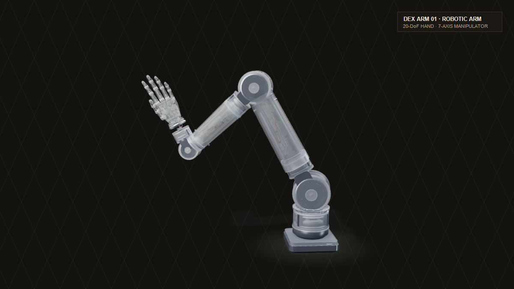
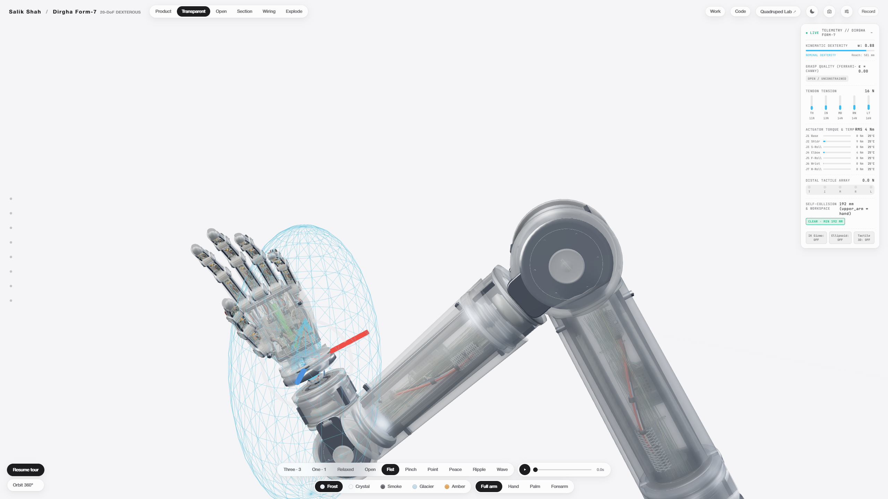
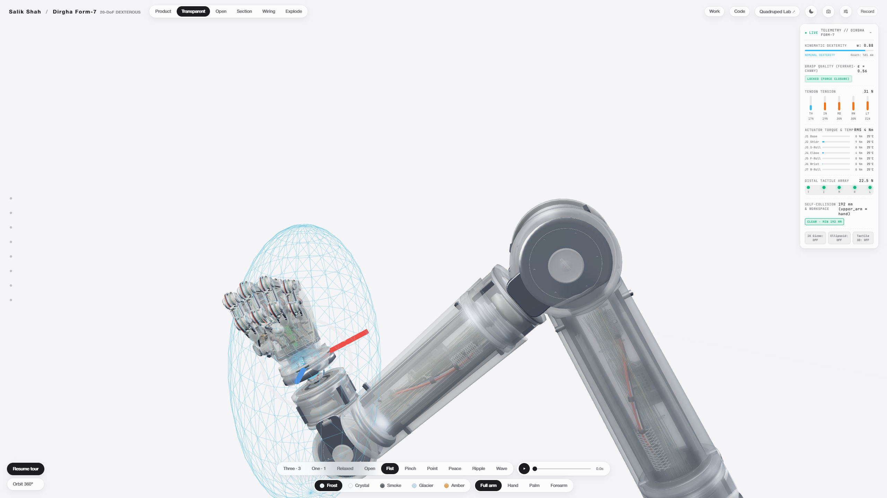
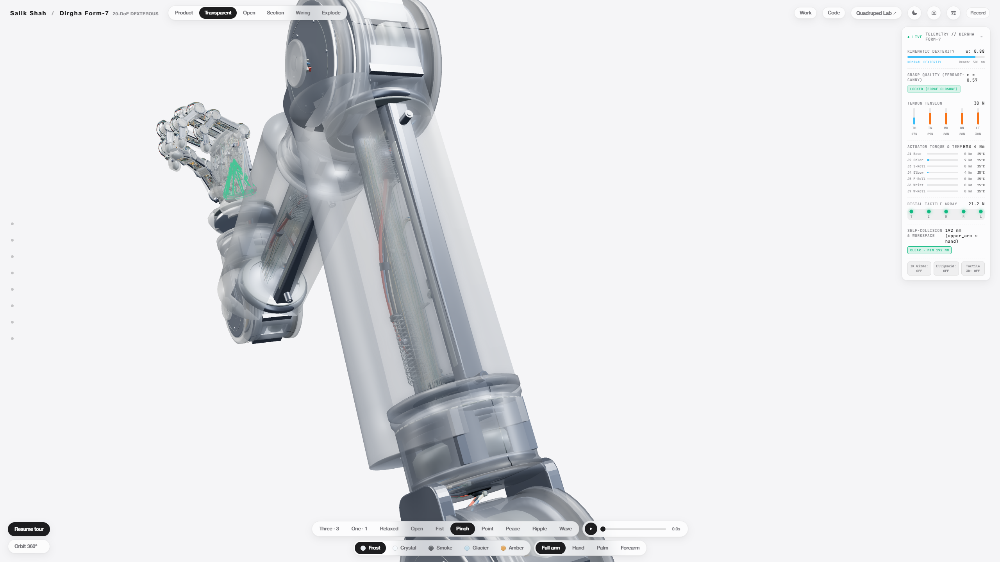
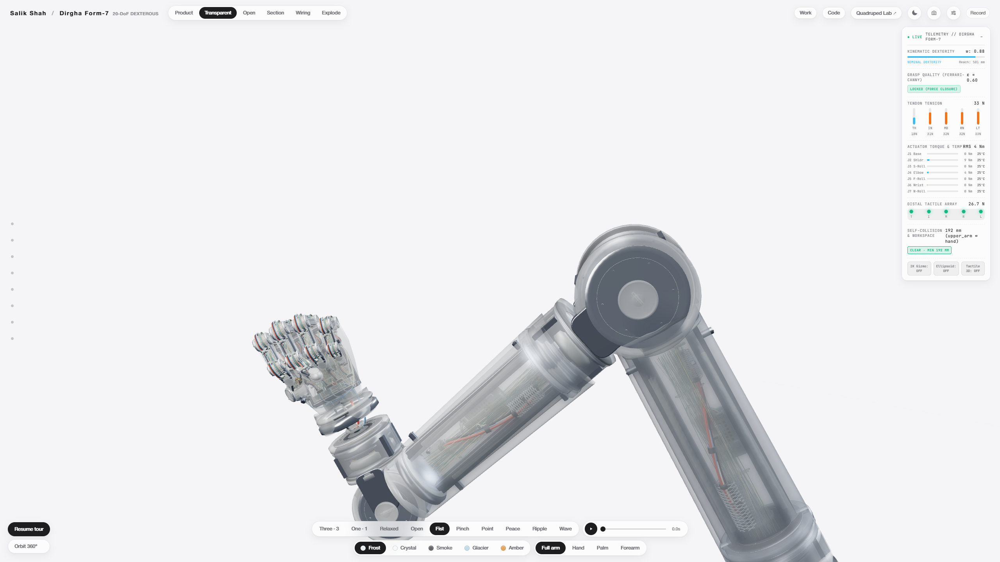

<h1 align="center">DEX ARM 01</h1>

<p align="center">
  <strong>Open-Source 7-Axis Robotic Manipulator &amp; 20-DoF Biomimetic Tendon Hand</strong><br />
  <em>A browser-native physical AI lab: 500 Hz MuJoCo WebAssembly physics, DLS inverse kinematics, LeRobot ACT imitation learning, WebXR teleoperation, and 1-click ROS 2 / MoveIt 2 package export.</em>
</p>

<p align="center">
  <a href="https://salikshah.com/work/dex-arm-01/"></a>
  <a href="https://huggingface.co/salik/dex-arm-01-act"></a>
  <a href="https://huggingface.co/datasets/salik/dex-arm-01-sim"></a>
  <a href="LICENSE"></a>
  <a href="https://github.com/google-deepmind/mujoco"></a>
  <a href="https://github.com/salikshah/dex-arm-01"></a>
</p>

<p align="center">
  
</p>

---

## What is DEX ARM 01?

**DEX ARM 01** is an open-source robotic manipulation research platform that combines a **7-axis redundant arm** with an **anthropomorphic 20-DoF tendon-driven hand**. 

Built from the ground up to run directly in modern web browsers, it eliminates the barrier of complex Linux setups, Docker containers, and CUDA drivers for robotics research:

- **For Beginners & Enthusiasts:** Experiment with robotic kinematics, motor torque limits, tendon routing, and contact physics in your browser with **zero installation**.
- **For AI & Robotics Researchers:** Train and evaluate imitation learning policies. Includes a pre-trained **Action Chunking with Transformers (ACT)** policy on Hugging Face, Hugging Face **LeRobot v3.0** simulation datasets, and instant export to **ROS 2**, **MoveIt 2**, **URDF**, and **MuJoCo MJCF**.

---

## 60-Second Quickstart

Choose the workflow that fits your needs:

### Option 1: Zero Install (Run in Your Browser)
Open the live simulation in Chrome, Edge, Brave, or Safari:  
👉 **[https://salikshah.com/work/dex-arm-01/](https://salikshah.com/work/dex-arm-01/)**

1. **Move Joints:** Drag any of the 27 joint sliders or click pose presets (*Neutral*, *Power Grasp*, *Pinch*, *Peace*, *Fist*).
2. **Test Physics:** Click **Physics Drop** to drop a procedural object into the palm and watch Google DeepMind's MuJoCo 500 Hz WASM engine compute real contact and retention forces.
3. **Plan Trajectories:** Click **Run 6-Stage Grasp Trajectory** to see minimum-jerk trajectory optimization.
4. **Export Code:** Click **Export ROS 2 / MoveIt 2** to instantly download a colcon-buildable package containing URDF, SRDF, MoveIt configs, and RViz launch files.

---

### Option 2: Run Locally (3 Commands)

No build tools, Webpack, or Vite required. DEX ARM 01 runs on standard Web Standards (ES Modules + Import Maps):

```bash
# 1. Clone the repository
git clone https://github.com/salikshah/dex-arm-01.git
cd dex-arm-01

# 2. Start any local static web server
npx serve .
# Or use Python:
# python -m http.server 3000

# 3. Open in your browser
# http://localhost:3000
```

To run offline physics tests with Node.js (v22+ recommended):
```bash
npm install               # installs MuJoCo WASM dev dependency
npm test                  # runs 22/22 unit tests (kinematics, physics, IK, ROS 2)
npm run test:e2e          # headless Chrome E2E verification
npm run bench             # runs 100 seeded MuJoCo drop trials
```

---

### Option 3: PyTorch Policy Inference (Hugging Face LeRobot)

Load the pre-trained ACT policy directly from the Hugging Face Hub using the official [huggingface/lerobot](https://github.com/huggingface/lerobot) library:

```python
import torch
from lerobot.common.policies.act.modeling_act import ACTPolicy

# 1. Load the pre-trained DEX ARM 01 ACT policy from Hugging Face
policy = ACTPolicy.from_pretrained("salik/dex-arm-01-act")
policy.eval()

# 2. Define 27-DoF observation state (7 arm joints + 20 finger joints in degrees)
observation = {
    "observation.state": torch.zeros(1, 27)
}

# 3. Predict the 27-DoF action trajectory chunk
with torch.no_grad():
    action = policy.select_action(observation)

print("Predicted 27-DoF action chunk:", action.shape)
```

Pre-trained weights and training artifacts:  
🔗 **Model:** [https://huggingface.co/salik/dex-arm-01-act](https://huggingface.co/salik/dex-arm-01-act)  
🔗 **Dataset:** [https://huggingface.co/datasets/salik/dex-arm-01-sim](https://huggingface.co/datasets/salik/dex-arm-01-sim)

---

## Visual Gallery & Engineering Specs

<p align="center">
  
  
</p>

<p align="center">
  
  
</p>

---

## Core Capabilities

| Subsystem | Specifications & Implementation Details |
| :--- | :--- |
| **7-Axis Arm Kinematics** | Spherical-wrist architecture (Base Yaw, Shoulder Pitch, Shoulder Roll, Elbow Pitch, Forearm Roll, Wrist Pitch, Wrist Roll). Harmonic drive gear ratios and torque limits. |
| **20-DoF Biomimetic Hand** | 5 digits (Thumb, Index, Middle, Ring, Little). 4 joints per digit (Abduction, MCP, PIP, DIP). Biomechanical 0.67 DIP/PIP tendon coupling constraint. |
| **DLS Inverse Kinematics** | 7-DoF Damped Least Squares solver ($\lambda = 0.04$) with null-space limit centering and real-time Yoshikawa manipulability ellipsoid calculation. |
| **MuJoCo WASM Physics** | Google DeepMind `@mujoco/mujoco@3.17.0` running at **500 Hz** (2 ms timestep), 27 position servos, 5 equality constraints, elliptic friction cone, and contact dynamics. |
| **Biomechanical Tendons** | $24 \times 20$ moment-arm matrix, Dyneema fiber cable routing, antagonistic pre-tension, and continuous tendon strain monitoring. |
| **Grasp Quality ($\varepsilon$)** | Ferrari-Canny Grasp Wrench Space (GWS) $\varepsilon$ metric calculated from contact normal vectors and friction cones. |
| **Tactile Telemetry** | Piezoresistive sensor pad simulation across 5 fingertips with live force vector visualization. |
| **Minimum-Jerk Planning** | 6-stage quintic minimum-jerk trajectory generator (`Home` $\to$ `Pre-Grasp` $\to$ `Approach` $\to$ `Contact` $\to$ `Grasp & Lift` $\to$ `Retract`). |
| **WebXR Teleoperation** | Real-time spatial teleoperation using WebXR Hand Tracking API (Meta Quest 3, Apple Vision Pro). Hand joint angles map directly into the 20-DoF finger pose and wrist IK. |
| **LeRobot v3.0 Dataset** | Built-in 30 Hz episode recorder outputting Parquet/JSONL datasets with standard LeRobot feature names (`observation.state`, `action`, `observation.images.wrist`). |
| **ROS 2 & MoveIt 2 Export** | Zero-dependency in-memory ZIP packager exporting a complete ROS 2 Iron/Jazzy workspace package (`dex_arm_01_description`) with URDF, SRDF, MoveIt 2 configs, and RViz launch scripts. |

---

## Kinematic Structure & Joint Limits

```
[World Base]
    │
    ├── J1: Base Yaw          (-180° to +180°, rated 42 Nm, max 120 Nm)
    ├── J2: Shoulder Pitch    (-120° to +120°, rated 42 Nm, max 120 Nm)
    ├── J3: Shoulder Roll     (-170° to +170°, rated 28 Nm, max  80 Nm)
    ├── J4: Elbow Pitch       (-150° to +150°, rated 28 Nm, max  80 Nm)
    ├── J5: Forearm Roll      (-170° to +170°, rated 14 Nm, max  35 Nm)
    ├── J6: Wrist Pitch       (-110° to +110°, rated 14 Nm, max  35 Nm)
    └── J7: Wrist Roll        (-180° to +180°, rated  8 Nm, max  20 Nm)
            │
            └── [20-DoF Biomimetic Tendon Hand]
                  ├── Thumb:  Abduction + CMC + MCP + IP  (coupled 0.72)
                  ├── Index:  Abduction + MCP + PIP + DIP (coupled 0.67)
                  ├── Middle: Abduction + MCP + PIP + DIP (coupled 0.67)
                  ├── Ring:   Abduction + MCP + PIP + DIP (coupled 0.67)
                  └── Little: Abduction + MCP + PIP + DIP (coupled 0.67)
```

---

## Directory Architecture

```
dex-arm-01/
├── index.html                # Interactive 3D simulation GUI & HUD shell
├── package.json              # Project metadata & npm test scripts
├── CITATION.cff              # Citation metadata for academic publications
├── LICENSE                   # MIT Open Source License
├── assets/
│   ├── cards/                # 16:9 Day and Night visual preview cards
│   └── press/                # High-resolution 2K technical studio renders
├── src/
│   ├── main.js               # Boot orchestrator, render loop, event dispatch
│   ├── model.js / geo.js     # WebGL 3D meshes & articulated node hierarchy
│   ├── pose.js               # 27-joint kinematic state & gesture interpolation
│   ├── ik-solver.js          # Damped Least Squares IK & Yoshikawa ellipsoid
│   ├── biomechanics.js       # 24x20 tendon matrix, GWS grasp quality, tactile vectors
│   ├── actuator-dynamics.js  # Harmonic drive torque & thermal models
│   ├── collision-checker.js  # Capsule-capsule self-collision distance queries
│   ├── benchmarks.js         # Procedural YCB objects (can, mug, stylus, cleanser)
│   ├── trajectory-player.js  # Quintic minimum-jerk trajectory planner & scrubber
│   ├── robot-specs.js        # URDF and MuJoCo MJCF XML procedural generators
│   ├── ros2-packager.js      # Zero-dependency in-memory ROS 2 ZIP exporter
│   ├── physics/
│   │   ├── mujoco-runtime.js # MuJoCo 3.17 WASM loader, servos, and contact solver
│   │   └── physics-scene.js  # Three.js ↔ MuJoCo coordinate bridge
│   └── teleop/
│       ├── hand-mapping.js   # 25-joint WebXR → 20-DoF finger pose mapper
│       ├── webxr-teleop.js   # Spatial tracking runtime & desktop mock driver
│       └── dataset-logger.js # 30 Hz LeRobot v3.0 episode recorder
├── hardware/                 # CAD scripts, BOM, and quick-swap tendon cartridge
├── notebooks/                # Google Colab ACT imitation learning training notebooks
├── scripts/
│   ├── record-sim-episodes.mjs # Headless MuJoCo dataset generator
│   ├── lerobot_convert.py      # JSONL → LeRobot v3.0 Parquet format converter
│   └── verify_lerobot_dataset.py # Live Hugging Face schema validator
├── tests/
│   ├── unit/                 # Node.js unit tests (22/22 passing)
│   └── e2e/                  # Headless Chrome CDP end-to-end tests
└── bench/                    # 100-drop seeded MuJoCo benchmark suite
```

---

## Verifying & Testing

### 1. Unit Tests (Node 22+)
Runs 22 comprehensive unit tests across kinematics, physics, IK, and ROS 2 exports:
```bash
npm test
```
```
✔ MJCF declares 7 arm + 20 hand joints and 27 actuators
✔ runtime maps commanded degrees into radians and drives the servos
✔ dropped object lands in an open palm and is retained when fingers close
✔ quaternion helpers agree with rotation matrices and rotations
✔ URDF exposes 7 arm and 20 hand revolute joints
✔ SRDF links and group states reference URDF names
✔ controller joint lists match the URDF exactly
✔ quintic profile has zero position, velocity and acceleration at both ends
✔ dataset info declares the LeRobot v3.0 layout
✔ recorder throttles to 30 Hz and emits valid JSONL
...
ℹ pass 22 | fail 0 | duration 2.2s
```

### 2. End-to-End Headless Chrome Tests
Launches an isolated headless Chrome instance over the Chrome DevTools Protocol (CDP) to verify 3D WebGL rendering, joint UI sliders, trajectory playback, and console health:
```bash
npm run test:e2e
```

### 3. Seeded MuJoCo Grasp Benchmark
Evaluates grasp retention across 100 randomized drop episodes with variable cylinder radii, masses, and contact friction:
```bash
npm run bench -- --episodes 100 --seed 7
```

---

## What is Real vs What is Simulated

We believe in strict engineering honesty. Here is what is mathematically verified in code versus what represents a hardware proposal:

| Claim | Status | Description |
| :--- | :--- | :--- |
| **27-DoF Kinematic Tree** | **Verified** | Real joint hierarchies, rotation pivots, and limit bounds. |
| **DLS IK & Manipulability** | **Verified** | Real numerical methods running at 60 Hz in browser. |
| **MuJoCo WASM Physics** | **Verified** | Genuine DeepMind physics compilation running rigid-body contacts at 500 Hz. |
| **LeRobot ACT Pipeline** | **Verified** | Fully trained policy available on Hugging Face; validated against live Hub schemas. |
| **ROS 2 / MoveIt 2 Export** | **Verified** | Valid colcon workspace with tested URDF, SRDF, and controller YAMLs. |
| **Tendon Tensions** | **Analytic** | Estimated via moment arms and pre-load; not measured with physical load cells. |
| **Harmonic Drive Thermals** | **Model** | Lumped $I^2R$ thermal resistance model. |
| **Physical Hardware** | **Proposal** | CAD files, BOM, and assembly scripts are provided in `hardware/`, but physical hardware has not yet been fabricated. |

---

## Exporting to ROS 2 & MoveIt 2

To use DEX ARM 01 in your native ROS 2 workspace:

1. Click **Export ROS 2 / MoveIt 2** in the browser interface (or call `exportROS2Package()` from `src/ros2-packager.js`).
2. Extract the downloaded `dex_arm_01_ros2.zip` into your ROS 2 workspace:
   ```bash
   mkdir -p ~/ros2_ws/src
   unzip dex_arm_01_ros2.zip -d ~/ros2_ws/src/
   
   # Build the package
   cd ~/ros2_ws
   source /opt/ros/iron/setup.bash    # or /opt/ros/jazzy/setup.bash
   colcon build --packages-select dex_arm_01_description
   source install/setup.bash
   
   # Launch and visualize in RViz 2
   ros2 launch dex_arm_01_description view_robot.launch.py
   ```

---

## Citation

If you use **DEX ARM 01** in academic research, benchmark studies, or physical AI projects, please cite it as:

```bibtex
@software{shah2026dexarm01,
  author       = {Salik Shah},
  title        = {DEX ARM 01: Open-Source 7-Axis Manipulator & 20-DoF Biomimetic Tendon Hand Lab},
  year         = {2026},
  publisher    = {GitHub},
  journal      = {GitHub repository},
  howpublished = {\url{https://github.com/salikshah/dex-arm-01}},
  url          = {https://salikshah.com/work/dex-arm-01/}
}
```

---

## Credits & Sources

- **Conceptual Genesis & Visual Art Direction:** The original 3D aesthetic and exploratory conceptual renders originated from creative work by [**@crystalsssup**](https://x.com/crystalsssup/status/2113684128734625948) & **Kimi 3.1 Pro**.
- **Robotics Systems & Scientific Architecture:** Converted into a mathematically verified, physically accurate robotics platform by **Salik Shah** (27-DoF kinematic tree, 500 Hz MuJoCo WASM contact simulation, 7-axis DLS inverse kinematics, minimum-jerk trajectory planning, and ROS 2 / MoveIt 2 packaging).
- **Academic & Engineering Sources:** Complete attribution for Google DeepMind MuJoCo, Hugging Face LeRobot & ACT, Three.js, and robotics kinematics/control literature (Yoshikawa, Flash & Hogan, Ferrari-Canny, Chiaverini) is documented in **[CREDITS.md](CREDITS.md)** and **[SOURCES.md](SOURCES.md)**.

---

## License

This project is licensed under the **MIT License** — see the [LICENSE](LICENSE) file for details.  
- [Three.js](https://threejs.org/) is MIT licensed.  
- [MuJoCo](https://mujoco.org/) is Apache-2.0 licensed by Google DeepMind.  
- Web fonts ([Literata](https://fonts.google.com/specimen/Literata), [Instrument Sans](https://fonts.google.com/specimen/Instrument+Sans), [JetBrains Mono](https://www.jetbrains.com/lp/mono/)) are licensed under the SIL Open Font License (OFL-1.1).

---

<p align="center">
  Initial 3D conceptual design by <a href="https://x.com/crystalsssup/status/2113684128734625948" target="_blank" rel="noopener">@crystalsssup</a> &amp; Kimi 3.1 Pro.<br />
  Architected &amp; engineered into an open-source physical AI lab by <a href="https://salikshah.com">Salik Shah</a>.
</p>
